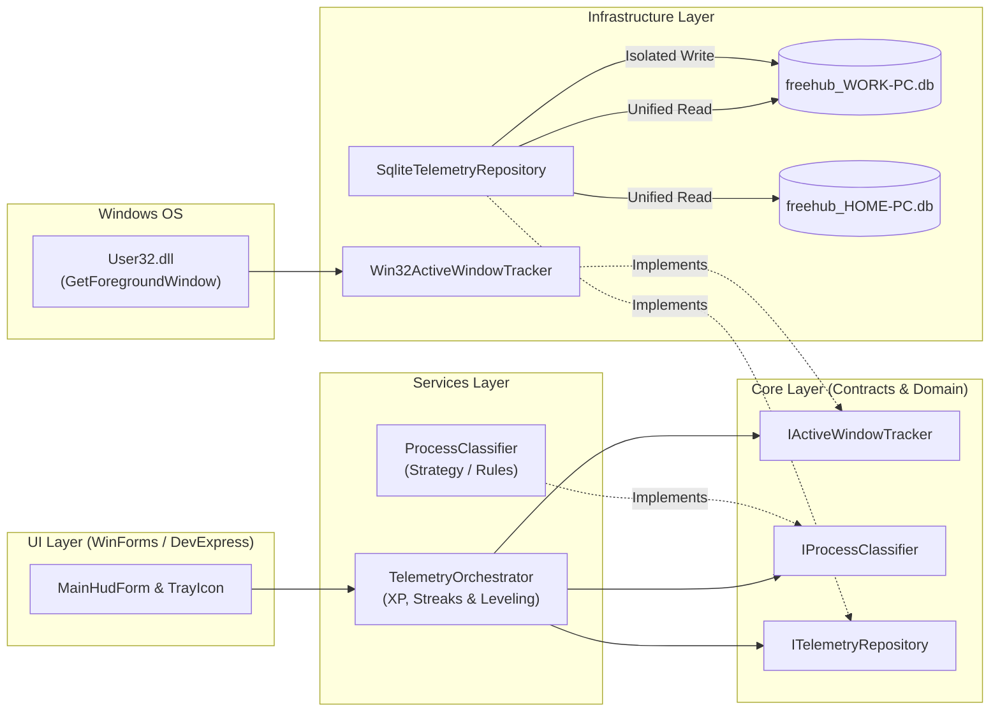

<div align="center">

# ⚡ FreeHub — Desktop Telemetry & Gamified Focus HUD

**Zero-manual-input Windows desktop telemetry utility ("Spotify Wrapped" for your PC + Passive RPG Progression)**

[](https://dotnet.microsoft.com/)
[](https://docs.microsoft.com/en-us/dotnet/csharp/)
[](https://www.microsoft.com/windows)
[](https://www.sqlite.org/)
[](https://www.devexpress.com/)

</div>

---

<details>
<summary>🇧🇷 <b>Resumo em Português (Clique para expandir)</b></summary>

<br/>

O **FreeHub** é um utilitário desktop para Windows focado em produtividade passiva e gamificação (ideal para TDAH, com recompensa visual imediata e **zero digitação manual de tarefas**). Ele roda silenciosamente na bandeja do sistema (*System Tray*) com um HUD estilo Gamer, monitorando automaticamente a janela ativa do sistema operacional via **Win32 API (`user32.dll`)**, classificando a atividade em tempo real (`Coding`, `Database`, `Gaming`, `Browsing`, `Idle`) e concedendo **XP passivo**, *combos de foco* e *level-ups*.

Possui uma arquitetura de **Sincronização Multi-Máquina Livre de Conflitos** via **SQLite + Google Drive**: cada computador grava apenas no seu próprio arquivo `freehub_<MACHINE>.db` com `Journal Mode=TRUNCATE`, enquanto a leitura unifica dinamicamente todos os bancos da pasta compartilhada.

</details>

---

## 🎯 Overview & Core Concept

Traditional time trackers fail because they require manual timers and constant task typing. **FreeHub** takes a completely passive, ADHD-friendly approach inspired by **RPG HUDs** and **Spotify Wrapped**:

1. **Zero Manual Input:** Runs quietly in the Windows System Tray and tracks foreground windows automatically via native Win32 P/Invoke (`User32.dll`).
2. **Real-Time Process Classification & Gamification:** Identifies what you are doing (`devenv` = **Coding**, `ssms`/`sqldeveloper` = **Database**, games = **Gaming**, browsers = **Browsing**) and rewards passive XP per minute, maintaining focus streaks/combos and triggering visual level-ups.
3. **Conflict-Free Multi-Machine Sync (SQLite + Cloud Folder):**
   * Designed to run seamlessly across multiple PCs (**Work PC**, **Home PC**, **Laptop**) synced via a shared Google Drive folder (`FreeHub_Data`).
   * **Write Isolation:** Each machine writes *exclusively* to its own SQLite database named after `Environment.MachineName` (e.g., `freehub_WORK-PC.db`, `freehub_HOME-PC.db`) configured with `Journal Mode=TRUNCATE;` to prevent `-wal`/`-shm` file lock conflicts on cloud drives.
   * **Unified Read Aggregation:** When rendering the HUD, Total XP, or analytics grids/charts, the repository dynamically discovers all `freehub_*.db` files in the directory and merges the telemetry into unified views.

---

## 🏗️ Architecture & Design Principles

The project strictly follows **SOLID**, **Clean Code**, and **Layered Architecture**, keeping business rules and SQLite persistence 100% decoupled from the Windows Forms UI code-behind.



### Key Patterns Applied
* **Repository Pattern (`ITelemetryRepository`):** Abstracts single-node SQLite writes and multi-node database discovery/aggregation.
* **Strategy / Rule Pattern (`IProcessClassifier`):** Extensible classification rules mapping process names and window titles to `ActivityCategory` and XP multipliers.
* **Dependency Injection via Constructor:** Explicit dependency graph wired at the Composition Root (`Program.cs`).
* **Strict Separation of Concerns:** Zero SQL queries or process inspection logic inside `Form` event handlers.

---

## 📂 Project Structure

```text
FreeHub/
 ├── Core/            # Domain Entities, Enums, and Contracts (ITelemetryRepository, IActiveWindowTracker, IProcessClassifier)
 ├── Infrastructure/  # SQLite multi-machine persistence, Google Drive path resolver, Win32 API P/Invoke (User32.dll)
 ├── Services/        # Process classification rules, XP/Streak/Level calculator, background Telemetry Orchestrator
 └── UI/              # Windows Forms HUD, System Tray (NotifyIcon) manager, and DevExpress 18.1 views
```

---

## 🛠️ Technical Stack & Constraints

| Component | Technology / Specification |
| :--- | :--- |
| **Target Framework** | `.NET Framework 4.6` |
| **Language Version** | Strictly **C# 7.3** (Visual Studio 2019 / MSBuild 15.0) |
| **Platform Target** | Strictly **x86 (32-bit)** (native Win32 & unmanaged SQLite interop compatibility) |
| **Database** | `System.Data.SQLite.Core` (`v1.0.118.0`) with `Journal Mode=TRUNCATE;` |
| **UI Framework (Phase 1)** | Pure Windows Forms (`Form`, `DataGridView`, `NotifyIcon`, `Timer`, `ProgressBar`) |
| **UI Framework (Phase 2)** | **DevExpress 18.1.5.0** (`XtraForm`, `GridControl`, `GridView`, `XtraCharts`, `AlertControl`, `ProgressBarControl`, `The Bezier` Dark Skin) |

---

## 🗺️ Development Roadmap

- [x] **Step 1 — Core Foundation & Project Setup**
  - [x] Configure strict `.NET Framework 4.6`, `C# 7.3`, and `x86` target build profile.
  - [x] Define domain models (`ActivityCategory`, `WindowActivityLog`, `ActiveWindowInfo`) and core interfaces (`ITelemetryRepository`, `IActiveWindowTracker`, `IProcessClassifier`).
- [ ] **Step 2 — Infrastructure Layer (Win32 + Multi-Machine SQLite)**
  - [ ] Implement `Win32ActiveWindowTracker` via `user32.dll` (`GetForegroundWindow`, `GetWindowThreadProcessId`, `GetWindowText`).
  - [ ] Implement `StoragePathResolver` and `SqliteTelemetryRepository` with isolated per-machine writes and unified multi-DB read aggregation.
- [ ] **Step 3 — Services & Gamification Engine**
  - [ ] Implement `ProcessClassifier` rules (`Coding`, `Database`, `Gaming`, `Browsing`, `Idle`).
  - [ ] Implement XP calculation, focus streak multipliers, and Level-Up events in `TelemetryService`.
- [ ] **Step 4 — Phase 1 UI (Pure Windows Forms)**
  - [ ] Build `MainHudForm` with real-time activity display, XP `ProgressBar`, `DataGridView` summary, and System Tray (`NotifyIcon`) integration.
- [ ] **Step 5 — Phase 2 UI Migration (DevExpress 18.1.5)**
  - [ ] Migrate to `XtraForm` with dark theme skinning (`The Bezier`), `GridControl`/`GridView`, `XtraCharts` telemetry breakdown, and `AlertControl` level-up toasts.

---

## 🚀 Getting Started

### Prerequisites
* **Windows OS** (Windows 10 / 11)
* **Visual Studio 2019** (or newer) with **.NET Desktop Development** workload
* **.NET Framework 4.6 Targeting Pack**

### Build & Run
1. Clone the repository:
   ```powershell
   git clone https://github.com/NortonPSouza/C--free-pulse.git
   cd C--free-pulse
   ```
2. Open `FreeHub.sln` in **Visual Studio 2019**.
3. Restore NuGet packages:
   * Right-click the solution in **Solution Explorer** $\rightarrow$ **Restore NuGet Packages** (or run `msbuild /t:Restore`).
4. Ensure the active solution platform is set to **`Debug | x86`** and press **`F5`** to build and launch.

---

## 📏 Commit Convention

This project follows the [Conventional Commits](https://www.conventionalcommits.org/) specification:

* `feat:` — New feature or capability (e.g., `feat(infra): implement Win32 foreground window tracker`)
* `fix:` — Bug fix (e.g., `fix(sqlite): handle locked database file during cloud sync`)
* `refactor:` — Code restructuring without changing external behavior
* `docs:` — Documentation updates (e.g., `docs: add architecture diagram and project roadmap to README`)
* `chore:` — Build scripts, `.csproj`, `.gitignore`, or dependency maintenance
