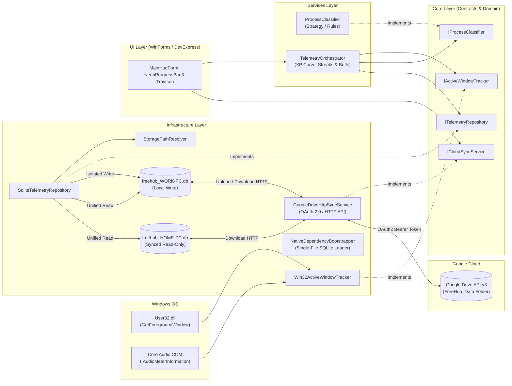

<div align="center">

# ⚡ FreeHub — Desktop Telemetry & Gamified Focus HUD

**Zero-manual-input Windows desktop telemetry utility ("Spotify Wrapped" for your PC + Passive RPG Progression)**

[](https://dotnet.microsoft.com/)
[](https://docs.microsoft.com/en-us/dotnet/csharp/)
[](https://www.microsoft.com/windows)
[](https://www.sqlite.org/)
[-4285F4?style=for-the-badge&logo=googledrive&logoColor=white)](https://developers.google.com/drive)
[](https://www.devexpress.com/)

</div>

---

<details>
<summary>🇧🇷 <b>Resumo em Português (Clique para expandir)</b></summary>

<br/>

O **FreeHub** é um utilitário desktop para Windows focado em produtividade passiva e gamificação (ideal para TDAH, com recompensa visual imediata e **zero digitação manual de tarefas**). Ele roda silenciosamente na bandeja do sistema (*System Tray*) com um HUD estilo Gamer, monitorando automaticamente a janela ativa do sistema operacional via **Win32 API (`user32.dll`)**, classificando a atividade em tempo real (`Coding`, `Database`, `Gaming`, `Browsing`, `Idle`) e concedendo **XP passivo**, *combos de foco*, **Buff de Música em Tempo Real (`Core Audio API`)** e *level-ups* com curva de progressão RPG.

Destaques técnicos:
1. **Persistência Local Ultrarrápida + Leitura Unificada:** Cada computador grava apenas no seu próprio arquivo `freehub_<MACHINE>.db` com `Journal Mode=TRUNCATE` e `Pooling=False`, enquanto o HUD unifica todos os bancos na visualização.
2. **Sincronização em Nuvem via Google Drive API v3 (HTTP / OAuth 2.0):** Login OAuth 2.0 via `TcpListener` em modo usuário para upload/download automático dos arquivos `.db` entre máquinas sem depender do cliente Google Drive Desktop.
3. **Executável Único Portátil (`FreeHub.exe`):** Embute `System.Data.SQLite.dll` e `SQLite.Interop.dll` (x86) como recursos internos extraídos automaticamente pelo `NativeDependencyBootstrapper`.

</details>

---

## 🎯 Overview & Core Concept

Traditional time trackers fail because they require manual timers and constant task typing. **FreeHub** takes a completely passive, ADHD-friendly approach inspired by **RPG HUDs** and **Spotify Wrapped**:

1. **Zero Manual Input & System Tray Persistence:** Runs quietly in the Windows System Tray (minimizing or closing with `X` keeps it alive in the tray; right-click $\rightarrow$ *Exit FreeHub* closes it) and tracks foreground windows automatically via native Win32 P/Invoke (`User32.dll`).
2. **Real-Time Process Classification & RPG Gamification:**
   * Classifies active processes (`devenv`/`antigravity`/`code` = **Coding**, `ssms`/`sqldeveloper` = **Database**, games = **Gaming**, browsers = **Browsing** with smart detection of developer docs like GitHub/Stack Overflow/Microsoft Learn).
   * **Scalable RPG XP Curve:** Level requirements scale dynamically ($100 \times \text{Level}^{1.35}$) so early levels reward quick dopamine while higher levels represent long-term milestones.
   * **Real-Time Audio Music Buff (`+10% XP`):** Queries the native Windows Core Audio peak meter (`IAudioMeterInformation`) in real time — playing music on Spotify/YouTube Music activates a live `+10% XP` buff that turns off immediately when paused.
3. **Dynamic Gamer HUD:**
   * **Owner-Drawn `NeonProgressBar`:** Custom GDI+ gradient progress bar with smooth interpolation, boost color shifting (Cyan-to-Emerald $\rightarrow$ Cyberpunk Violet-to-Neon when Streak/Music Buff is active), and interactive mouse-over telemetry stats.
   * **Live Priority `DataGridView`:** Automatically pins the currently active category and machine to the top row (`ACTIVE NOW`), highlights it in neon emerald, and calculates each category's `% Share`.
4. **Conflict-Free Multi-Machine Sync (Local SQLite + Google Drive HTTP API):**
   * **Write Isolation:** Each machine writes *exclusively* to its own local SQLite database named after `Environment.MachineName` (`freehub_<MACHINE>.db`) with `Journal Mode=TRUNCATE;` and `Pooling=False;`.
   * **Cloud Sync via HTTP (OAuth 2.0):** Built-in `GoogleDriveHttpSyncService` authenticates via OAuth 2.0 Loopback (`TcpListener` + `HttpClient`) to upload the local machine's `.db` and download other machines' `freehub_*.db` files.
   * **Single-File Portable `.exe`:** `NativeDependencyBootstrapper` embeds and resolves both managed and native x86 SQLite assemblies directly from inside `FreeHub.exe`.

---

## 🏗️ Architecture & Design Principles

The project strictly follows **SOLID**, **Clean Code**, and **Layered Architecture**, keeping business rules and SQLite persistence 100% decoupled from the Windows Forms UI code-behind.



---

## 📂 Project Structure

```text
FreeHub/
 ├── Core/            # Domain Entities, Enums, and Contracts (ITelemetryRepository, IActiveWindowTracker, IProcessClassifier, ICloudSyncService)
 ├── Infrastructure/  # SQLite multi-machine persistence, path resolver, Google Drive OAuth2 HTTP sync, Win32 & CoreAudio P/Invoke, Single-File Bootstrapper
 ├── Services/        # Process classification rules, scalable RPG XP curve, Streak & Music Buff calculator, Telemetry Orchestrator
 ├── UI/              # MainHudForm, custom GDI+ NeonProgressBar, CloudSyncSetupForm, custom vector HudIconFactory, System Tray manager
 └── Resources/       # Custom application icon (freehub.ico)
```

---

## 🛠️ Technical Stack & Constraints

| Component | Technology / Specification |
| :--- | :--- |
| **Target Framework** | `.NET Framework 4.6` |
| **Language Version** | Strictly **C# 7.3** (Visual Studio 2019 / MSBuild 15.0) |
| **Platform Target** | Strictly **x86 (32-bit)** (native Win32 & unmanaged SQLite interop compatibility) |
| **Database** | `System.Data.SQLite.Core` (`v1.0.119.0`) with `Journal Mode=TRUNCATE;` & `Pooling=False;` |
| **Cloud Sync** | Local folder discovery + **Google Drive REST API v3** (`OAuth 2.0` HTTP upload/download) |
| **UI Framework (Phase 1)** | Pure Windows Forms (`Form`, custom GDI+ `NeonProgressBar`, dark-styled `DataGridView`, `NotifyIcon`, `Timer`) |
| **UI Framework (Phase 2)** | **DevExpress 18.1.5.0** (`XtraForm`, `GridControl`, `GridView`, `XtraCharts`, `AlertControl`, `ProgressBarControl`, `The Bezier` Dark Skin) |

---

## 🗺️ Development Roadmap

- [x] **Step 1 — Core Foundation & Project Setup**
  - [x] Configure strict `.NET Framework 4.6`, `C# 7.3`, and `x86` target build profile.
  - [x] Define domain models (`ActivityCategory`, `WindowActivityLog`, `ActiveWindowInfo`) and core interfaces (`ITelemetryRepository`, `IActiveWindowTracker`, `IProcessClassifier`, `ICloudSyncService`).
- [x] **Step 2 — Infrastructure Layer (Win32 + CoreAudio + Multi-Machine SQLite)**
  - [x] Implement `Win32ActiveWindowTracker` via `user32.dll` and real-time audio detection via Windows Core Audio (`IAudioMeterInformation`).
  - [x] Implement `StoragePathResolver` and `SqliteTelemetryRepository` with isolated per-machine writes and unified multi-DB read aggregation.
- [x] **Step 3 — Services & RPG Gamification Engine**
  - [x] Implement `ProcessClassifier` rules (`Coding`, `Database`, `Gaming`, `Browsing`, `Idle`).
  - [x] Implement scalable RPG XP curve ($100 \times \text{Level}^{1.35}$), focus streak multipliers, real-time Music Buff (`+10% XP`), and Level-Up events in `TelemetryOrchestrator`.
- [x] **Step 4 — Phase 1 UI (Pure Windows Forms), Cloud Sync & Single-File `.exe`**
  - [x] Build `MainHudForm` with custom GDI+ `NeonProgressBar` (smooth animation + interactive hover telemetry), active-first dark `DataGridView`, custom vector `.ico`, and System Tray persistence.
  - [x] Implement `GoogleDriveHttpSyncService` (OAuth 2.0 Loopback via `TcpListener` + `HttpClient`) and `NativeDependencyBootstrapper` for single-file portable `FreeHub.exe` deployment.
- [ ] **Step 5 — Phase 2 UI Migration (DevExpress 18.1.5)**
  - [ ] Migrate to `XtraForm` with dark theme skinning (`The Bezier`), `GridControl`/`GridView`, `XtraCharts` telemetry breakdown, and `AlertControl` level-up toasts.

---

## 📏 Commit Convention

This project follows the [Conventional Commits](https://www.conventionalcommits.org/) specification:

* `feat:` — New feature or capability
* `fix:` — Bug fix
* `refactor:` — Code restructuring without changing external behavior
* `docs:` — Documentation updates
* `chore:` — Build scripts, `.csproj`, `.gitignore`, or dependency maintenance
